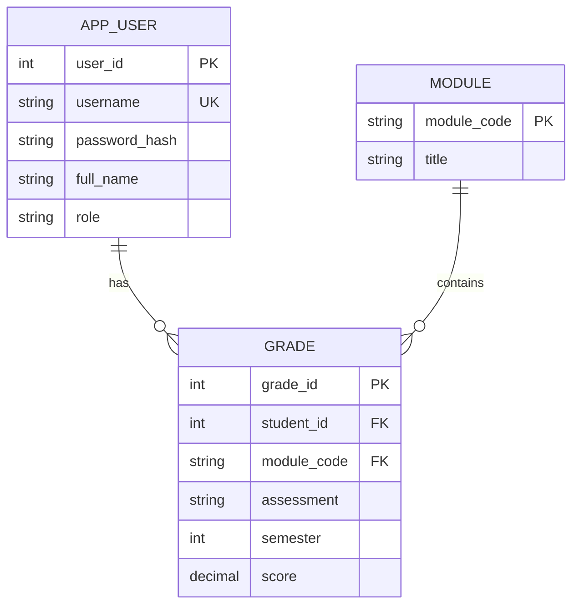

# Student Grades Analytics

A web app where **students** see their own results with charts, and **lecturers** see class statistics per
module and enter new grades. Built with plain **Jakarta Servlets** (no Spring), **JDBC**, **MySQL** and a
**JavaScript + Chart.js** front end, packaged as a WAR for **Tomcat 10**.

Built to practise Server-Side and Client-Side Web Development, Relational Databases and Probability & Statistics.

## Features
- Login with **hashed passwords** (PBKDF2-HMAC-SHA256 with a random salt per user, from the JDK - no plain text stored)
- **Role-based access**: a servlet filter blocks students from lecturer endpoints and vice versa; students can
  only ever see their own grades (their id comes from the session, not the URL)
- Student dashboard: mean, median, standard deviation, min/max, average per module (bar chart),
  grade distribution by degree band (First / 2.1 / 2.2 / Pass / Fail), trend by semester (line chart)
  and a **predicted next-semester average** from a least-squares trend line
- Lecturer dashboard: the same statistics per module, number of **students at risk** (average < 40),
  and a form to add grades (validated on the server)
- Prepared statements everywhere, HTML escaping in the front end, HttpOnly session cookie,
  new session id after login

## Architecture
```
Browser (HTML + JS + Chart.js)  --fetch JSON-->  Servlets  -->  Services  -->  DAOs (JDBC)  -->  MySQL
```
```
web/       AuthFilter, LoginServlet, LogoutServlet, MeServlet, StudentReportServlet, LecturerServlet,
           AppContext (wires everything on startup), Json (Gson helpers)
service/   AuthService (login), AnalyticsService (builds reports)
stats/     GradeStatistics (mean, median, SD, distribution, linear trend), GradeBand
security/  PasswordHasher (PBKDF2)
dao/       UserDao, GradeDao + JDBC implementations
webapp/    index.html (login), student.html, lecturer.html, js/, css/
```
The statistics and services do not depend on servlets or the database, so they are unit tested with fakes.

### API
| Method | Path | Who | Description |
|---|---|---|---|
| POST | `/api/login` | anyone | `{username, password}` -> starts a session |
| POST | `/api/logout` | logged in | ends the session |
| GET | `/api/me` | logged in | current user |
| GET | `/api/student/report` | student | own grades + statistics |
| GET | `/api/lecturer/modules` | lecturer | module codes |
| GET | `/api/lecturer/module?code=CS201` | lecturer | module statistics |
| GET | `/api/lecturer/students` | lecturer | student list |
| GET | `/api/lecturer/student?id=2` | lecturer | one student's report |
| POST | `/api/lecturer/grades` | lecturer | add a grade |

### ER diagram


## How to run
Requirements: Java 17+, Maven, Docker.
```bash
mvn package                 # runs the tests and builds target/grades.war
docker compose up           # MySQL (with demo data from db/schema.sql) + Tomcat 10
```
Open http://localhost:8080 and log in as **akshay** (student) or **lecturer** - the password is `password123`.

To create a hash for a new user: `mvn compile exec:java -Dexec.args="newpassword"`.

Without Docker: create the database with `db/schema.sql`, set `DB_URL`, `DB_USER`, `DB_PASSWORD`
environment variables and copy `target/grades.war` into Tomcat 10's `webapps/` folder.

## How to test
```bash
mvn test
```
- `GradeStatisticsTest` - mean, median, sample SD, band distribution, linear trend
- `PasswordHasherTest` - hashing, salting, verification
- `ServicesTest` - student/module reports, at-risk count, validation and login, using in-memory fake DAOs

## Possible improvements
- CSRF tokens, account management page, CSV upload of grades, per-assessment weighting.
